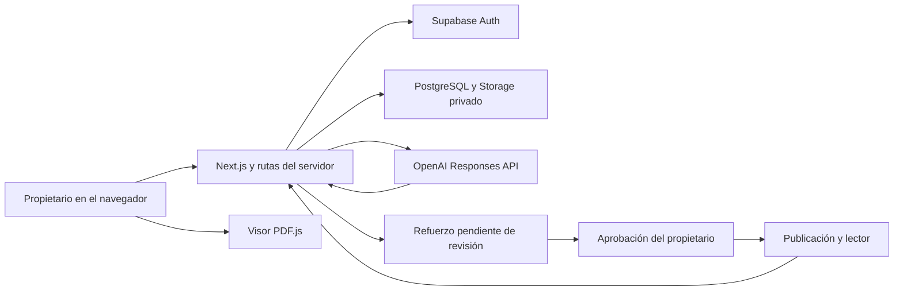

# Guía para estudiar PDF Interactivo

PDF Interactivo ayuda a comprender un documento PDF mediante refuerzos ligados
a una página o fragmento. El propietario prepara y revisa el material; el lector
consulta la publicación, responde quizzes y puede valorar su claridad.

El PDF original se conserva. Los refuerzos y sus versiones se guardan por
separado: enriquecer la experiencia no significa sobrescribir el archivo.

## Explicación breve para la presentación

«La aplicación permite cargar un PDF, seleccionar una parte difícil y explicar
qué no se entiende. La IA analiza ese contexto y propone formas de reforzarlo.
El propietario elige un formato, revisa el contenido y decide si lo aprueba.
Después comparte una publicación que el lector puede consultar con sus
refuerzos y quizzes. El sistema conserva el original, controla los accesos y
registra resultados y opiniones».

## Cómo se conectan las partes

| Parte | Responsabilidad |
| --- | --- |
| Next.js, React y TypeScript | Pantallas, navegación y operaciones del servidor. |
| Tailwind | Estilos y adaptación del diseño a distintos tamaños. |
| Zod | Validación de entradas y estructuras recibidas de la IA. |
| PDF.js | Lectura, renderizado y extracción del texto digital. |
| Supabase Auth | Identidad y sesiones. |
| PostgreSQL con RLS | Datos y aislamiento entre propietarios. |
| Supabase Storage | Archivos PDF y recursos guardados. |
| OpenAI Responses API | Análisis y generación estructurada con GPT. |
| Vercel | Ejecución de la web y sus funciones por HTTPS. |

La aplicación desplegada no depende de que el computador del desarrollador esté
encendido. Sí depende de sus servicios remotos y de su configuración.

## Recorrido del propietario

1. Inicia sesión y carga un PDF en un proyecto.
2. Abre el visor, cambia de página o zoom y marca un texto o una zona.
3. Escoge una categoría de dificultad y explica qué parte no entiende.
4. Extrae, corrige si hace falta y confirma el texto del borrador.
5. Envía la solicitud. A partir de ese momento, el contenido enviado es inmutable.
6. Revisa el contexto y solicita el análisis de IA.
7. Consulta las recomendaciones y guarda una elección; elegir no genera contenido.
8. Configura y genera el refuerzo, revisa su calidad y sus referencias, y lo aprueba.
9. Cuando corresponde, prepara y revisa un mini quiz.
10. Revisa la publicación y decide su modalidad de acceso.

Guardar una dificultad en el borrador no equivale a enviar la solicitud. El
borrador es temporal: se conserva al cerrar el formulario dentro del proyecto,
pero puede descartarse al recargar o salir. Una solicitud enviada sí persiste.

## Qué hace la IA

El servidor prepara el fragmento, la dificultad y texto de la misma página.
El modelo devuelve una estructura definida; el sistema valida sus campos y que
las citas correspondan al contexto enviado. Si falta contexto, debe explicar
qué información falta y detener la generación de ese recorrido.

La integración actual es un flujo de análisis y generación controlado por la
aplicación. No es un agente autónomo que navegue por Internet o ejecute acciones
libres. No se entrenó un modelo nuevo con los PDF del usuario.

GPT puede producir texto y datos estructurados para recursos visuales y quizzes.
Un diagrama estructurado no equivale a generar un video. Los medios adjuntados
por el propietario y los recursos generados tienen recorridos distintos.
Tampoco hay OCR: un PDF escaneado sin texto digital requiere transcripción manual.

El modelo configurado es gpt-6.1-sol. Las claves permanecen en el servidor.
Cambiar automáticamente a otro proveedor ante un error no forma parte del flujo.
Los fallos de cuota, tiempo de espera o formato no deben convertirse en contenido
aprobado ni en reintentos ilimitados.

## Publicación, lector y resultados

La publicación reúne el PDF y los refuerzos aprobados. Los borradores quedan
fuera de la publicación. El servidor comprueba que el enlace y la versión sigan
vigentes; retirar o sustituir una publicación cambia lo que puede consultar
el lector.

El quiz se califica en el servidor. Sus respuestas correctas no deben exponerse
antes de responder. Los reintentos se permiten según la configuración del quiz;
los ensayos privados del propietario se distinguen de los intentos de lectores.

El lector puede indicar si un refuerzo fue útil o sigue sin ser claro y añadir
un comentario. La opinión debe quedar ligada al refuerzo correcto. Las métricas
de visitas, aperturas, resultados y opiniones ayudan a revisar el material.

## Seguridad y conservación

- Los permisos se comprueban en el servidor; ocultar un botón no basta.
- RLS restringe las filas accesibles a cada usuario. Las claves privadas no
  se envían al navegador.
- Las operaciones firmadas y el control de versión protegen el contexto y
  evitan sobrescrituras desde una pestaña antigua.
- La idempotencia permite recuperar una operación repetida sin duplicar registros.
- La aprobación editorial se exige antes de mostrar un refuerzo al lector.
- Las evidencias de Jira registran lo observado; una prueba automática o una
  emulación no se presenta como una prueba manual en otro navegador o dispositivo.

## Qué consume IA y qué no

Pedir un análisis o generar contenido puede consumir crédito API. Consultar un
refuerzo ya guardado o calificar un quiz existente no necesita una nueva
generación del modelo. Los costos de IA, alojamiento, base de datos, correo y
dominio son conceptos distintos.

El dominio vercel.app permite visitar el QA. El remitente de pruebas de Resend
solo admite actualmente el correo del titular; la recuperación para otras
cuentas requiere un dominio de envío verificado.

## Estado que puedes defender con evidencia

Corte actualizado: 9 de noviembre de 2026. El QA ejecutó con gpt-6.1-sol el recorrido real
de diagnóstico suficiente, tres recomendaciones pertinentes sin preselección,
explicación Intermedio y mini quiz de tres preguntas. El caso de energía
distingue cantidad total y cambio de forma, conserva las condiciones del PDF
y no incorpora su línea distractora. Una aprobación editorial explícita fue
necesaria antes de publicar; generar no publicó ni aprobó automáticamente.

El lector HTTPS mostró la explicación y calificó 2/3, con corrección y razones
por pregunta. Recargar conservó el resultado y bloqueó reintentos. Otro cliente
HTTP, sin sesión de propietario, obtuvo 3/3; repetir la misma operación devolvió
el mismo intento y otro envío recibió 409. Las soluciones no estaban en la
respuesta inicial del lector. Se retiró después únicamente la publicación QA:
lectura, PDF e intentos pasaron a 404, conservando contenido y resultados.

La suite actual aprobó 472 pruebas, lint y build. El QA aprobó cinco contratos
HTTP con revisión exacta e0152fb. Se corrigió un aviso que sugería reintentar
una solicitud insuficiente inmutable: ahora exige una nueva solicitud más
completa. El escaneado con transcripción mínima se rechazó antes de llamar a
IA. Ambos PDF mantienen sus SHA-256. Las capturas auténticas y las evidencias
anteriores se conservan en Jira; no se sustituyeron por resultados esperados.

El 09/11 se repitió el recorrido desde una carga nueva en
[QA-PRESENTACION-20261109](https://pdf-interactivo-qa.vercel.app/projects/7155218d-eca7-4b89-a309-ea6fa9d74125),
con diagnóstico, recomendaciones, explicación y quiz nuevos de Sol. Hubo
revisión explícita, lector 2/3 persistido y cliente HTTP independiente 3/3.
Retirar bloqueó cuatro rutas; republicar creó un enlace nuevo válido y dejó
el anterior invalidado. El documento sintético queda disponible para demostrar
la lectura. Su contenido guardado se consulta sin otra generación de IA.

Usage del equipo mostró margen: funciones 4.898/1.000.000, transferencia
150,28 MB/100 GB y CPU 5m41s/4h en la ventana de 30d visible. Esto no garantiza
disponibilidad futura ni acredita el saldo OpenAI. Se repitieron 20/20 regresiones
críticas y 5/5 contratos públicos, sin cambios de código o nuevo despliegue.

Quedan verificaciones formales de navegadores, gesto táctil y avisos operativos.
No afirmar compatibilidad completa con Safari ni vigilancia continua mientras
esas comprobaciones no estén realizadas. El detalle vigente y los bloqueos
están en [la continuidad](CONTEXTO-PROYECTO.md) y
[operación y compatibilidad](OPERACION-Y-COMPATIBILIDAD.md).

## Acceso desde el celular para la presentación

Dirección del QA: https://pdf-interactivo-qa.vercel.app/dashboard.
Abrirla desde el teléfono e iniciar sesión personalmente. La sesión del PC no
se transfiere al celular. Se necesita conexión a Internet para consultar el
servidor y generar contenido con IA. No hay APK, manifiesto PWA ni service
worker en esta versión; no se promete instalación nativa o uso sin conexión.

En Android/Chrome, abrir el sitio y usar el menú de opciones para añadirlo a la
pantalla de inicio; el nombre del control puede variar según la versión.
En iPhone/Safari, abrir Compartir y Añadir a la pantalla de inicio. Ese acceso
abre el sitio y no descarga el proyecto ni cambia los permisos de los datos.
Fuentes de los controles: [Motorola/Chrome](https://help.motorola.com/hc/3184/11/na/es-es/CGjcb110912808.html)
y [Apple/Safari](https://support.apple.com/es-us/guide/iphone/iph42ab2f3a7/27/ios/27).

El tamaño móvil emulado en el PC no acredita una instalación ni una prueba en
un teléfono real. La verificación del dispositivo debe registrarse por separado.

## Preguntas que conviene practicar

1. ¿Por qué se guardan los refuerzos separados del PDF original?
2. ¿Qué diferencia hay entre borrador, solicitud enviada y refuerzo aprobado?
3. ¿Por qué el servidor verifica las citas y la propiedad del documento?
4. ¿Qué hace el sistema si el contexto es insuficiente o falla el proveedor?
5. ¿Cómo evita duplicar solicitudes o intentos ante un doble envío?
6. ¿Qué ocurre cuando el propietario retira o sustituye una publicación?
7. ¿Por qué responder un quiz no requiere consultar otra vez a GPT?
8. ¿Qué se ha probado realmente y qué falta para una entrega definitiva?
